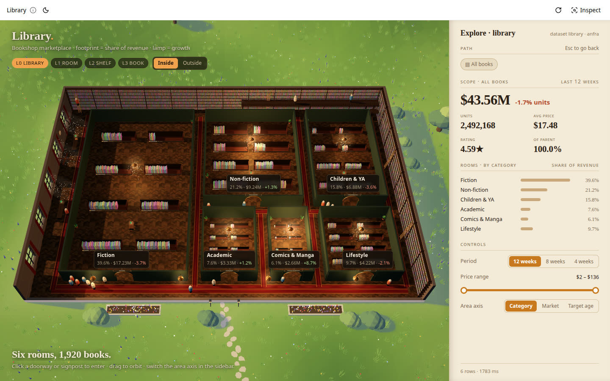
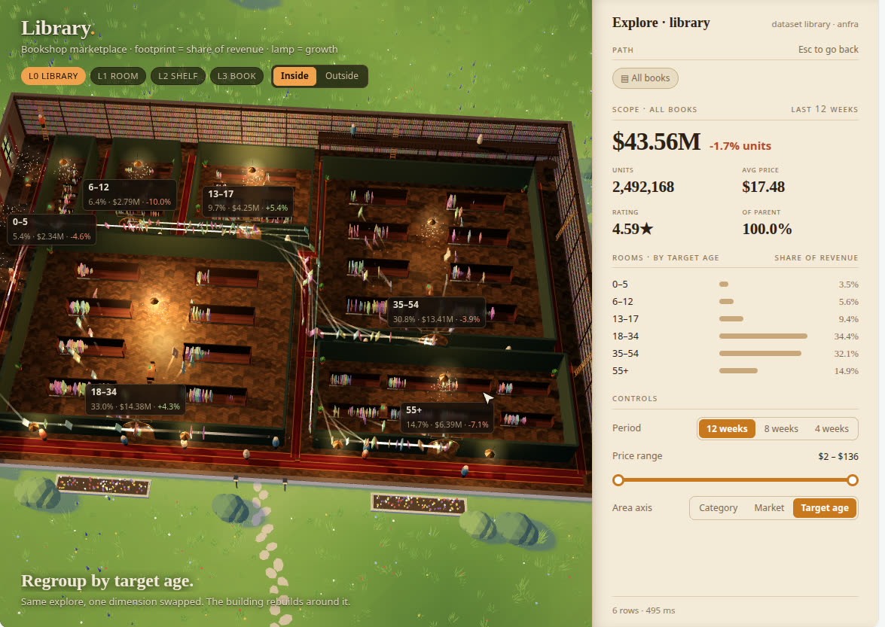
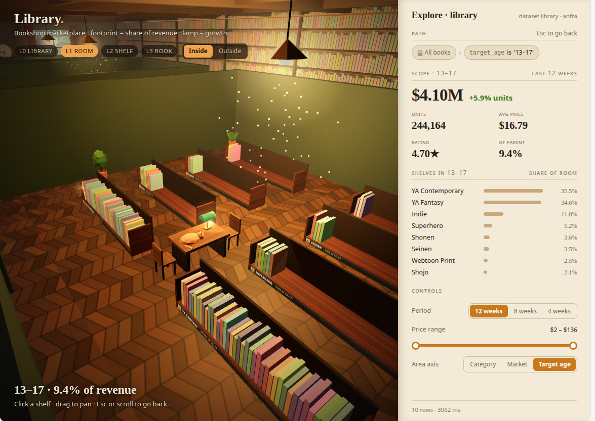
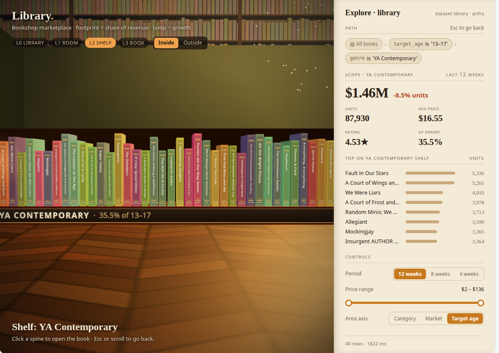
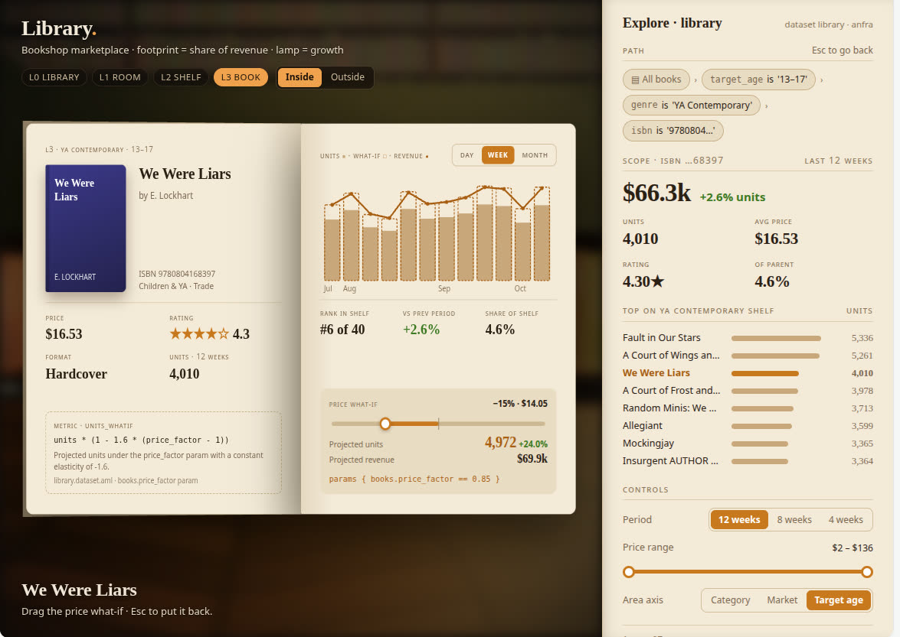
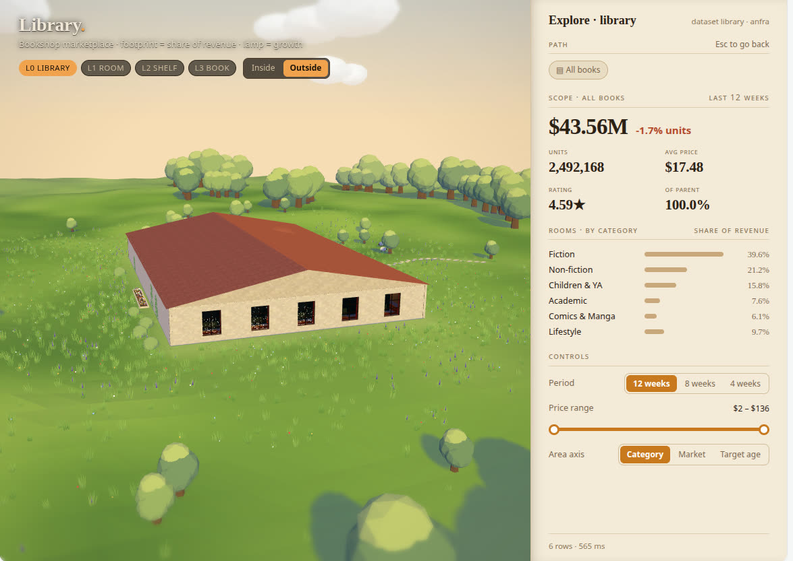
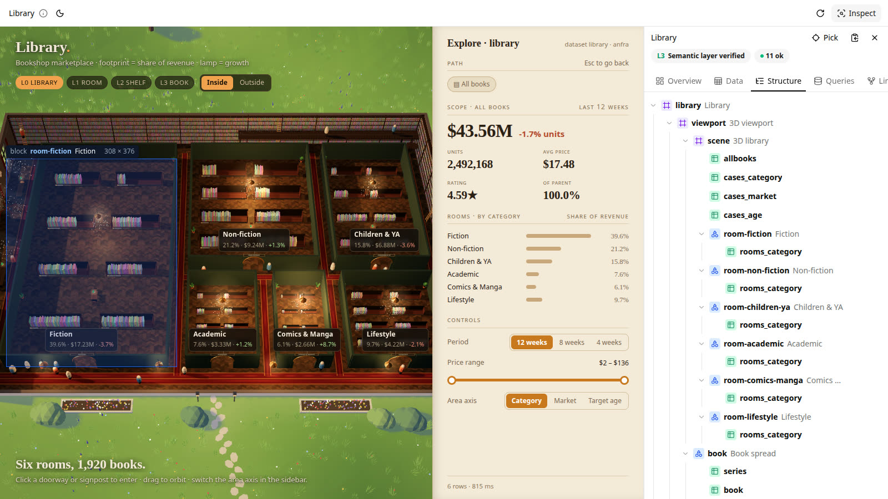
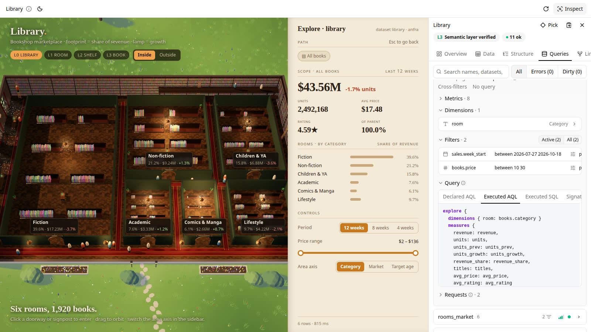

# anfra Library: the Data App and its host

The Library Data App (a 3D drill-down over a governed anfra semantic layer, built for the 2026 anfra App
Competition) together with the custom host that shows it with anfra's toolbar and Inspect panel, packaged
as one container image.

Live: https://anfra-library.pages.holistics.dev (public, no auth). The app is at `/`.


## Screenshots

| | |
|---|---|
|  Bird's eye: six rooms sized by revenue share, lamps by growth, the paper sidebar with the live filter chips |  Regroup by target age: the same explore with one dimension swapped; spines stream between rooms as the building rebuilds |
|  Inside a room: eight bookcases ranked by revenue, fill = the genre's share of the room |  A shelf: the top 40 titles by units, hover for title · units · change vs the previous period |
|  A book: weekly series, rank, share of shelf, and the price what-if driven by the `price_factor` param |  Outside: the same building in its field |
|  Inspect › Structure: every room, shelf and book is a block the panel can pick, hover outlines it in the scene |  Inspect › Queries: the executed AQL and SQL behind the numbers on screen |

## Prerequisites

- NixOS, or Nix with flakes (`experimental-features = nix-command flakes`). Nothing else: node, pnpm, gh, skopeo,
  proto, anfra, duckdb, proot all come from the flake.
- Git access to the private sources the flake pins, with your own credentials:
  - `holistics/anfra` (input `anfra-src`, nix's GitHub fetcher): an `access-tokens = github.com=<token>` line in
    `~/.config/nix/nix.conf`.
  - `holistics/prototypes-deploy` (input `proto-src`, the `proto` CLI, branch `k8s` at a pinned rev): fetched with
    git over https, so your git credential helper (e.g. `gh auth setup-git`).
  - the sidecar release repos `holistics/holistics-core` (anfra-node v0.8.0) and `holistics/canal` (canal-query
    2.19.1): no nix fetcher can download a private release asset, so the flake pins them by sha256 (`requireFile`)
    and `nix run .#fetch-sidecars` downloads them once with `gh` (logged in: `nix develop -c gh auth login`),
    checks the hashes and adds them to the store. It leaves a `result-sidecars` GC root in the repo.
- For deploys, a classic GitHub token with `repo` + `write:packages`, as `PROTO_GITHUB_TOKEN` in the environment
  or in a `.env` at the repo root (git-ignored): `PROTO_GITHUB_TOKEN=ghp_...`.

## Layout

| Path | What |
|---|---|
| `app/` | The anfra Data Folder: `models/`, `datasets/` (AML), `src/` + `build.mjs` (the app's source and esbuild build; `apps/library.html` is generated by `pnpm build` and not kept in git), `data/` (`library.duckdb` and the pipeline that makes it), `.anfra/` (`data_sources.yml.example`, `context_sources.yml`). Its own doc: [`app/README.md`](app/README.md). |
| `host/` | The host: a fork of [holistics/anfra-host-example](https://github.com/holistics/anfra-host-example) (Apache-2.0, `host/LICENSE`, `host/NOTICE`), cut down to the one app. Hono server + React page. What changed and how to run it: [`host/NOTES.md`](host/NOTES.md); upstream doc: `host/README.md`. |
| `flake.nix`, `flake.lock` | Dev shell; packages `anfra` (v0.11.1 from source), `sidecars`, `proto`, `library-app`, `host`, `image`; app `fetch-sidecars`. |
| `smoke.sh` | Unpack the image and run it under proot (no Docker), then check `/health`, `/`, the app file and one query. |
| `deploy.sh` | Build the image, push it to GHCR, update the prototypes deployment. |

## Commands

Every command runs from the repo root. `smoke.sh` and `deploy.sh` re-run themselves inside `nix develop`.

```sh
nix run .#fetch-sidecars        # once per machine (gh login with access to holistics-core + canal)
nix develop                     # node 22, pnpm 11, tsc, esbuild, duckdb, anfra, proto, gh, skopeo, jq, curl, proot
                                # ANFRA_NODE_BIN / ANFRA_CANAL_QUERY_BIN point at the pinned sidecars

# dev: core-only anfra + the host with hot reload
cp app/.anfra/data_sources.yml.example app/.anfra/data_sources.yml   # set the absolute path to app/data/library.duckdb
(cd app && pnpm install && pnpm build)     # generates app/apps/library.html (not in git)
(cd app && ANFRA_SITE_URL=http://localhost:5173 anfra serve --no-apps --addr 127.0.0.1:7878) &
(cd host && pnpm install && ANFRA_REPO=$PWD/../app ANFRA_URL=http://127.0.0.1:7878 pnpm dev)   # http://localhost:5173/
# or anfra's built-in pages, without the host
(cd app && anfra serve --addr 127.0.0.1:3000)   # http://127.0.0.1:3000/apps/library

nix build .#image               # build the container (pure: no --impure, no env vars)
./smoke.sh [result]             # smoke-test it under proot (builds .#image when no path is given)
nix flake check                 # evaluates everything; builds the app (tsc + bundle)
./deploy.sh                     # build, push, proto deploy (BUILD_ONLY=1 ./deploy.sh stops after the build)
```

anfra allows one `serve` per repo: run the core-only server or the built-in one, not both.

## Image

`nix build .#image` (x86_64-linux; `dockerTools.buildLayeredImage`, linux/amd64, ~233 MB compressed). Every
input comes from the flake: anfra (source build, web UI embedded), the pinned sidecars in `/opt/anfra`, node 22,
the Data Folder in `/srv/library` (`packages.library-app`: `app/` from the flake's own source, `tsc` checked and
bundled in nix; no `node_modules`, `src`, raw data or build files; its own `.anfra/data_sources.yml` pointing at
`/tmp/lib/data/library.duckdb`), the host in `/srv/host` (`packages.host`: `vite build` + `tsc`, production
`node_modules`), bash, coreutils, CA certs, tzdata, fakeNss. The flake only sees files git tracks (new files need
`git add`).

The start command (bash):

1. `cp -rL /srv/library /tmp/lib`: the image layer is read-only and anfra needs a writable repo (runtime file,
   sidecar sockets, DuckDB's WAL).
2. `anfra serve --no-apps --no-watch --no-mcp --addr 127.0.0.1:7878` in the background, with
   `ANFRA_SITE_URL=https://anfra-library.pages.holistics.dev`. anfra is reachable only from inside the
   container; it has no authentication.
3. `exec node dist/server/main.js` from `/srv/host` (`NODE_ENV=production ANFRA_REPO=/tmp/lib
   ANFRA_URL=http://127.0.0.1:7878 PORT=8080 HOSTNAME=0.0.0.0 TRUST_PROXY=1`): the host is the container's
   main process. It answers `/health` with 503 until anfra is up, so the platform's readiness probe does the
   waiting; if the host dies the container exits and the pod restarts; if anfra dies the host's health check
   fails and the liveness probe restarts the pod.

`ANFRA_PORT` and `PORT` override 7878 and 8080, only so the image can be smoke-tested next to other servers
(`smoke.sh` uses 17878 and 18080).

## Deploy

```sh
echo 'PROTO_GITHUB_TOKEN=ghp_...' > .env    # once; or export PROTO_GITHUB_TOKEN
./deploy.sh                                 # or: nix develop -c ./deploy.sh
```

It builds `.#image`, pushes `ghcr.io/holistics/anfra-library:sha-<UTC minute>` with skopeo (the policy file and
the image out-link go in a temp dir), then `proto deploy --image … --port 8080 --name anfra-library --yes`.

## Platform facts

- The deployment is PR #144 (`preview/anfra-library`) on `holistics/prototypes-deploy`. Keep it open;
  do not merge or close it. `proto status anfra-library`, `proto logs anfra-library`.
- Public, no password gate for image deploys. The data is synthetic sales plus public book metadata.
- The PR's `values.yaml` (hand-edited, kept across redeploys) targets port 8080 and mounts an `emptyDir`
  at `/tmp`; the root filesystem may be read-only. Memory limit 1 GiB; anfra + sidecars use ~480 MB, node ~100 MB.
- A fresh image can answer 503 for a minute or two while the pod starts.

## Three gotchas from the first deploy

| Symptom | Cause | Fix |
|---|---|---|
| Pod never ready | A nix image has no `/etc/passwd`, `/etc/group`, `nsswitch.conf`; anfra's OS-user lookup and the DuckDB sidecar need them. | `dockerTools.fakeNss` in `contents`, plus `/etc/hosts` and `/etc/localtime`. |
| `anfra-node is not responding … /tmp/anfra-1.sock` | Nothing writable for the sidecar sockets, the runtime file and DuckDB's WAL. | `emptyDir` at `/tmp`; the Data Folder is copied there at start. |
| "No Data Apps yet" | `cp -r` kept nix store symlinks; anfra's app scanner skips symlinked files. | `cp -rL`. |

The sidecars are dynamically linked against glibc: the image adds the `/lib64/ld-linux-x86-64.so.2` symlink
and `LD_LIBRARY_PATH` with gcc's lib and glibc.

## Notes

- `anfra-src` is `github:holistics/anfra/v0.11.1`; `proto-src` is `holistics/prototypes-deploy` at
  `b309b23` (branch `k8s`). Both are private: see Prerequisites.
- `.gitignore` used to say `result*`, which also ignored `host/src/inspector/ui/shared/result-table.tsx`, so a
  clean checkout could not build the host. It now says `/result*`.
- skopeo's own GHCR login (`--dest-creds`) failed every push here with 403 ("trying to reuse blob … 403"); `deploy.sh` fetches one registry token with curl and passes `--dest-registry-token` instead.
